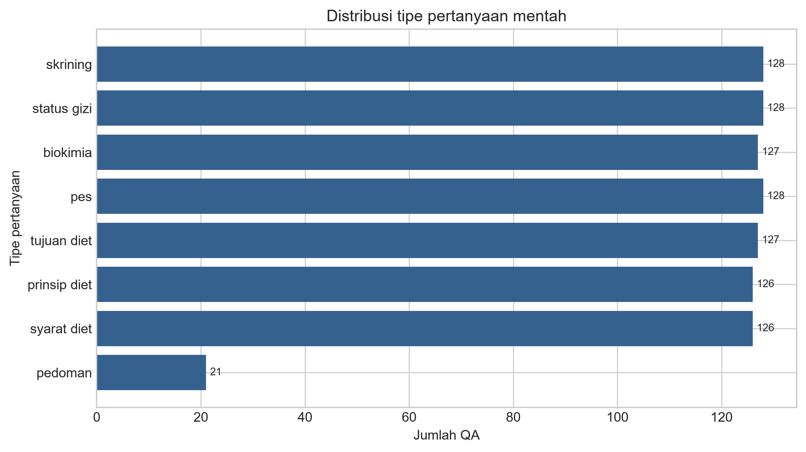
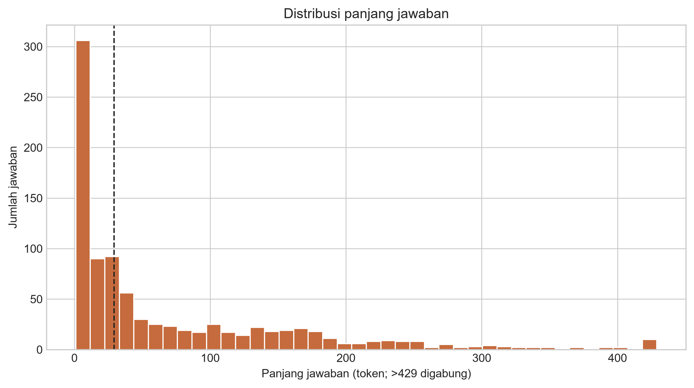
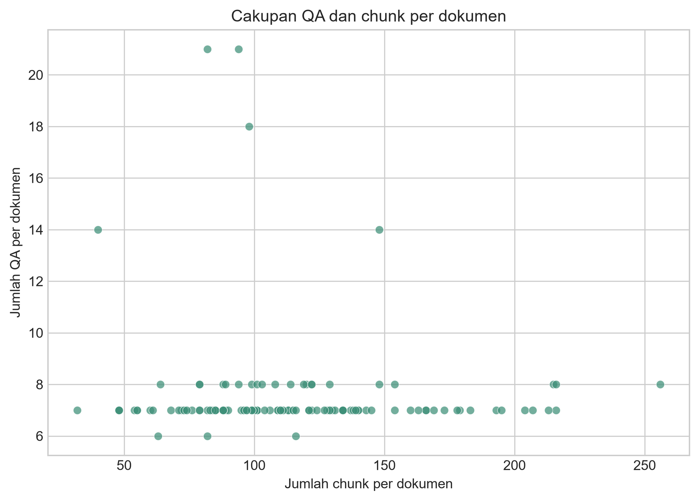

# Tahap 1 — Pemahaman dan Audit Data Mentah

Tanggal analisis: 15 Oktober 2026

## Ruang lingkup

Analisis ini membaca `data/dataset/dataset.json` dan 120 berkas JSON dalam `data/chunks/` tanpa mengubah sumber. Semua angka agregat dapat ditelusuri ke `results/eda/summary.json`; salinan non-sensitifnya tersedia di `reports/01_eda_summary.json`. Script reproduksi adalah `scripts/run_eda.py`.

Panjang teks dihitung dengan tokenisasi regex `\w+` setelah *lowercase*. Audit nama file memakai normalisasi NFKC, konversi pola `#Uxxxx` ke Unicode, dan penghapusan karakter `U+2060`.

## Ringkasan sumber

| Komponen | Jumlah |
|---|---:|
| QA mentah | 911 |
| ID QA unik | 911 |
| Dokumen QA | 120 |
| Berkas chunk | 120 |
| Total chunk | 13.737 |
| Nama PDF unik dalam chunk | 120 |
| Template pertanyaan | 8 |

Seluruh QA mempunyai sepuluh field yang diharapkan dan seluruh chunk mempunyai empat field yang diharapkan. Tidak ditemukan field wajib yang hilang, `null`, kosong, atau tidak terduga.

Rata-rata terdapat 7,59 QA per dokumen (median 7; rentang 6–21) dan 114,48 chunk per dokumen (median 109; rentang 32–256).

## Distribusi pertanyaan

Pemetaan delapan template ke tipe bersifat satu-ke-satu dan tidak ada template di luar pemetaan.

| Tipe | QA mentah | Dokumen dengan tipe |
|---|---:|---:|
| Skrining | 128 | 120 |
| Status gizi | 128 | 120 |
| Biokimia | 127 | 119 |
| PES | 128 | 120 |
| Tujuan diet | 127 | 120 |
| Prinsip diet | 126 | 119 |
| Syarat diet | 126 | 119 |
| Pedoman | 21 | 21 |

Tujuh tipe utama hampir seimbang (126–128 QA), tetapi tipe pedoman hanya berjumlah 21 QA atau 2,31% data. Karena split dilakukan per dokumen dan setiap bagian harus memuat semua tipe, dokumen yang memiliki tipe pedoman menjadi kendala utama pembentukan split.



## Duplikasi

Kunci duplikasi yang ditetapkan adalah `(file, question)`. Terdapat 35 kelompok berulang dengan total 53 baris ekstra; ukuran kelompok terbesar adalah tiga. Dengan mempertahankan satu baris per kunci, jumlah yang diharapkan sesudah deduplikasi adalah 858 QA.

| Pemeriksaan | Nilai |
|---|---:|
| Kelompok duplikat | 35 |
| Baris ekstra | 53 |
| Ukuran kelompok maksimum | 3 |
| Perkiraan QA setelah deduplikasi | 858 |

Transformasi deduplikasi belum dilakukan pada tahap ini dan akan diverifikasi pada Tahap 2.

## Rekonsiliasi nama file dan join

Semua 120 nama dokumen QA cocok literal dengan 120 nama berkas chunk pada hasil ekstraksi saat ini. Normalisasi wajib tetap menghasilkan 120 kecocokan tanpa collision. Tidak ditemukan pola `#Uxxxx`; satu nama pada masing-masing sumber mengandung karakter tak terlihat `U+2060` dan berubah setelah normalisasi.

Join berdasarkan `(file, page_number, chunk_index)` berhasil pada 911/911 QA, baik sebelum maupun sesudah normalisasi. Tidak ada kunci chunk duplikat. Isi `context` sama persis dengan `text` chunk pada 899 QA, sedangkan 12 QA memiliki perbedaan walaupun identitas kuncinya cocok. Oleh karena itu, identitas gold pada tahap berikutnya harus memakai kunci chunk, bukan kesamaan teks.

| Pemeriksaan | Hasil |
|---|---:|
| Nama dokumen cocok literal | 120/120 |
| Nama dokumen cocok setelah normalisasi | 120/120 |
| Collision normalisasi | 0 |
| QA berhasil join | 911/911 |
| Context sama persis | 899/911 |
| Context berbeda | 12/911 |

## Validitas jawaban

Setiap QA memiliki tepat satu teks jawaban dan satu `answer_start`; tidak ada ketidaksamaan panjang array. Hanya 79/911 offset (8,67%) yang menunjuk jawaban secara tepat. Angka yang sama merupakan jumlah jawaban yang ditemukan verbatim dalam `context`; 832 jawaban (91,33%) tidak ditemukan sebagai substring literal.

Temuan ini mengonfirmasi bahwa `answer_start` tidak dapat digunakan untuk qrels. Label gold ketat akan berasal dari identitas chunk pada metadata. Label multi-gold akan memakai tumpang tindih token jawaban sesuai protokol, bukan offset karakter.

## Panjang teks

| Teks | Min | Q1 | Median | Rata-rata | Q3 | Maks |
|---|---:|---:|---:|---:|---:|---:|
| Pertanyaan (token) | 6 | 6 | 9 | 8,46 | 10 | 11 |
| Jawaban (token) | 1 | 7 | 29 | 71,78 | 107,5 | 692 |
| Context QA (token) | 8 | 124 | 142 | 130,70 | 151 | 192 |
| Chunk (token) | 4 | 88 | 132 | 118,68 | 146 | 468 |
| Jawaban (karakter) | 3 | 49 | 212 | 498,53 | 780,5 | 4.847 |
| Context QA (karakter) | 60 | 848,5 | 1.000 | 882,15 | 1.000 | 1.000 |
| Chunk (karakter) | 44 | 598 | 980 | 796,27 | 1.000 | 1.029 |

Panjang jawaban sangat menceng ke kanan: median 29 token, tetapi rata-rata 71,78 token dan maksimum 692 token. Banyak context berhenti tepat pada 1.000 karakter, konsisten dengan batas panjang proses chunking sumber.



## Cakupan dokumen

Mayoritas dokumen memiliki tujuh QA; nilai 14, 18, dan 21 terutama menunjukkan pengulangan template sebelum deduplikasi. Jumlah chunk jauh lebih bervariasi dan memengaruhi tingkat kesulitan retrieval per pasien.



## Implikasi untuk tahap berikutnya

1. Rekonsiliasi Tahap 2 harus membuktikan alur 911 → 858 setelah deduplikasi → 858 setelah join → 858 final.
2. Normalisasi nama file tetap wajib diterapkan agar `U+2060`, NFKC, dan bentuk `#Uxxxx` aman bila data diekstrak ulang.
3. Dua belas perbedaan `context` akan diaudit tanpa menyalin teks klinis ke laporan; chunk yang ditunjuk metadata menjadi sumber gold.
4. `answer_start` diabaikan sepenuhnya.
5. Pencarian split harus memastikan tipe pedoman hadir di koleksi, dev, dan test untuk semua sepuluh seed.

## Reproduksi

```powershell
.\.venv\Scripts\python.exe scripts\run_eda.py
```

