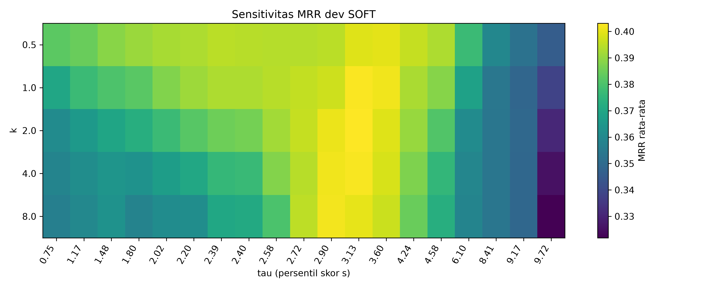

# Baseline, PRF Klasik, dan Metode Inti BM25

Tanggal: 15 Oktober 2026

## Ruang lingkup

Pemilihan Tahap 5 hanya memakai data dev pada pengulangan seed 1–3 (2.052 kombinasi query–skenario). Data test belum dibaca untuk pemilihan parameter. Evaluasi memakai satu chunk gold ketat dan pemecahan skor seri stabil berdasarkan urutan chunk.

## Tuning dasar SOFT

Grid `m ∈ {1,3,5}` dan `r ∈ {1,3,5}` dievaluasi. Untuk setiap pasangan, `k ∈ {0,5;1;2;4;8}` dan `tau` pada persentil 5–95 skor question similarity disetel ulang. Referensi kendala adalah konfigurasi awal `m=3, r=3`; kandidat hanya layak bila tidak ada skenario turun lebih dari 0,01.

| m | r | k terbaik | tau terbaik | TPL | NEW | PARA | PNEW | Rata-rata |
|---:|---:|---:|---:|---:|---:|---:|---:|---:|
| 5 | 3 | 2,0 | 3,1251 | 0,6133 | 0,3587 | 0,3577 | 0,2826 | **0,4031** |
| 5 | 5 | 4,0 | 2,9027 | 0,6101 | 0,3676 | 0,3559 | 0,2768 | 0,4026 |
| 5 | 1 | 0,5 | 3,5972 | 0,6032 | 0,3301 | 0,3818 | 0,2700 | 0,3963 |
| 3 | 3 | 1,0 | 3,1251 | 0,5718 | 0,3450 | 0,3622 | 0,2817 | 0,3902 |

Konfigurasi dasar dibekukan pada `m=5`, `r=3`. Parameter `k=2` dan `tau=3,1251` adalah hasil dev seed 1–3 untuk audit Tahap 5; pada run final keduanya tetap disetel ulang dari dev tiap pengulangan sebagaimana protokol.

## Hasil dev konfigurasi BM25

| Metode | TPL | NEW | PARA | PNEW | Rata-rata |
|---|---:|---:|---:|---:|---:|
| B0 | 0,2085 | 0,2085 | 0,1412 | 0,1412 | 0,1748 |
| B1 | 0,2994 | 0,2994 | 0,1890 | 0,1890 | 0,2442 |
| RM3 | 0,3149 | 0,3149 | 0,1971 | 0,1971 | 0,2560 |
| P-EXT | 0,3442 | 0,3442 | 0,2570 | 0,2570 | 0,3006 |
| P-QA | 0,6143 | 0,1876 | 0,4351 | 0,1879 | 0,3562 |
| P-FUS | 0,5041 | 0,2964 | 0,3704 | 0,2474 | 0,3546 |
| ZONE3 | 0,6120 | 0,2983 | 0,3476 | 0,2790 | 0,3842 |
| **SOFT** | **0,6133** | **0,3587** | **0,3577** | **0,2826** | **0,4031** |
| SOFT-SM | 0,5709 | 0,3573 | 0,3378 | 0,2739 | 0,3850 |
| ORACLE-W | 0,6643 | 0,4066 | 0,5081 | 0,3409 | 0,4800 |

RM3 terbaik memakai `fb_docs=5`, `fb_terms=30`, dan interpolasi 0,5. ZONE3 memakai persentil 33/67 distribusi skor `s`. SOFT-SM memakai temperatur 1,0.

## Interpretasi sementara

- SOFT mengungguli B1 sebesar 0,1589 MRR rata-rata dev dan tetap lebih baik pada keempat skenario.
- P-QA sangat kuat saat tipe tersedia, tetapi turun di NEW/PNEW; pola ini mendukung kebutuhan bobot adaptif.
- P-EXT lebih stabil daripada P-QA di topik baru, sedangkan ORACLE-W menunjukkan masih ada jarak 0,0769 menuju pemilihan sumber ideal.
- Hasil dekat dengan sanity check: selisih B1 rata-rata 0,0208 dan SOFT 0,0121, jauh di bawah ambang penyelidikan 0,15.
- Seluruh angka berasal dari `results/stage5/dev_metrics.csv`, `base_tuning.csv`, `soft_grid.csv`, `rm3_grid.csv`, dan `per_query.csv`.

## Kriteria lolos

- [x] B0, B1, RM3, P-EXT, P-QA, P-FUS, ZONE3, SOFT, SOFT-SM, dan ORACLE-W berjalan di dev.
- [x] Parameter dasar `m=5, r=3` dibekukan hanya dari dev.
- [x] Heatmap sensitivitas `k,tau` tersedia dan lolos pemeriksaan visual.
- [x] Unit test sigmoid, min-max, RRF, feedback berbobot, dan pemecahan seri lulus.
