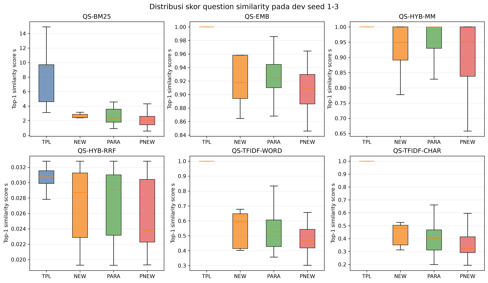

# Analisis Komponen

## Protokol dan pemisahan data

Analisis ukuran question similarity dan retriever chunk memakai dev seed 1–3, sama dengan proses seleksi Tahap 6. Nilai `k` dan `tau` dituning ulang pada dev untuk setiap kandidat. Dua varian tambahan, TF-IDF kata dan TF-IDF karakter n-gram 3–5, dihitung setelah FINAL terkunci hanya untuk analisis; keduanya tidak boleh mengubah konfigurasi FINAL.

Analisis reranker dan dekomposisi memakai hasil test final dari 10 seed. Parameter reranker pada setiap seed telah dipilih dari dev sebelum test dibangun. Dengan demikian, data test hanya dipakai untuk mengukur kontribusi konfigurasi yang sudah terkunci, bukan untuk memilih komponen.

## Pengaruh ukuran question similarity

TF-IDF memakai lowercase dan cosine similarity dengan IDF halus `log((1 + N)/(1 + df)) + 1`. Varian kata memakai unigram `\w+`; varian karakter memakai n-gram 3–5 setelah normalisasi spasi. Tabel berikut adalah MRR dev gabungan seed 1–3.

| Metode | k | tau | TPL | NEW | PARA | PNEW | Rata-rata | Lolos kendala |
|---|---:|---:|---:|---:|---:|---:|---:|:---:|
| QS-BM25 | 2 | 3,1251 | 0,6133 | 0,3587 | 0,3577 | 0,2826 | 0,4031 | Ya |
| QS-EMB | 8 | 0,9451 | 0,5793 | 0,3225 | 0,4449 | 0,2853 | 0,4080 | Tidak |
| QS-HYB-MM | 8 | 0,9485 | 0,5775 | 0,3173 | 0,4676 | 0,2703 | 0,4082 | Tidak |
| QS-HYB-RRF | 8 | 0,0226 | 0,5577 | 0,3028 | 0,4603 | 0,2583 | 0,3948 | Tidak |
| QS-TFIDF-WORD | 8 | 0,5487 | 0,6139 | 0,3101 | 0,4008 | 0,2777 | 0,4006 | Tidak |
| QS-TFIDF-CHAR | 8 | 0,4814 | 0,6140 | 0,3228 | 0,3707 | 0,2763 | 0,3959 | Tidak |

QS-EMB dan QS-HYB-MM mempunyai rata-rata sedikit lebih tinggi daripada QS-BM25, terutama karena PARA, tetapi menurunkan TPL dan NEW jauh melewati batas 0,01. TF-IDF kata mempertahankan TPL dan menaikkan PARA sebesar 0,0430, tetapi NEW turun 0,0486. TF-IDF karakter juga mempertahankan TPL, namun NEW turun 0,0360. Karena tidak ada varian tambahan yang memenuhi kendala antarskenario, keputusan QS-BM25 tetap sah dan tidak diubah setelah melihat hasil.

### Distribusi skor similarity

Gambar memperlihatkan skor top-1 `s` pada 2.052 observasi dev. Sumbu-y setiap panel mengikuti skala metodenya sendiri dan tidak boleh dibandingkan langsung antar-panel. QS-BM25 memisahkan TPL dengan jelas dari skenario lain: median TPL sekitar 9, sedangkan NEW, PARA, dan PNEW berada sekitar 2–3. Skor embedding jauh lebih rapat pada kisaran tinggi; seluruh TPL bernilai 1 karena template yang sama tersedia di koleksi. Hybrid min-max juga terkonsentrasi dekat 1, sedangkan RRF memiliki rentang numerik sangat sempit. TF-IDF menghasilkan TPL tepat 1 dan skor lebih rendah pada skenario non-template.

Perbedaan skala ini menjelaskan mengapa `tau` tidak dapat dipindahkan antarmetode dan selalu dituning ulang bersama `k`. Distribusi juga menunjukkan bahwa kemiripan tinggi pada ruang embedding tidak otomatis berarti pemisahan skenario yang lebih baik.

### Ketepatan tipe feedback

Ketepatan adalah proporsi dari lima jawaban feedback teratas yang tipe pertanyaannya sama dengan query. NEW dan PNEW tidak disertakan karena QA bertipe sama sengaja dikeluarkan oleh desain leave-one-type-out.

| Metode | TPL | PARA |
|---|---:|---:|
| QS-BM25 | 1,0000 | 0,5926 |
| QS-EMB | 1,0000 | 0,7719 |
| QS-HYB-MM | 1,0000 | 0,7173 |
| QS-HYB-RRF | 1,0000 | 0,7501 |
| QS-TFIDF-WORD | 1,0000 | 0,5750 |
| QS-TFIDF-CHAR | 1,0000 | 0,5439 |

Semua metode sempurna pada TPL karena pertanyaan template identik tersedia dalam koleksi. Pada PARA, QS-EMB paling akurat memilih tipe feedback (77,19%), tetapi QS-HYB-MM memberi MRR PARA tertinggi (0,4676). Jadi ketepatan tipe membantu, tetapi bukan satu-satunya penentu: isi jawaban feedback dan interaksinya dengan retriever chunk juga memengaruhi rank gold.

## Pengaruh retriever chunk

Analisis memakai QS-BM25 terpilih dan parameter terbaik masing-masing retriever pada dev seed 1–3. Dua cara ekspansi dense adalah embedding teks query yang sudah diperluas secara penuh dan vektor Rocchio dari embedding query serta feedback. Hybrid menggabungkan ranking BM25 dan dense dengan RRF.

| Retriever | Cara ekspansi | k | tau | TPL | NEW | PARA | PNEW | Rata-rata |
|---|---|---:|---:|---:|---:|---:|---:|---:|
| R-BM25 | Weighted query | 2 | 3,1251 | 0,6133 | 0,3587 | 0,3577 | 0,2826 | 0,4031 |
| R-DENSE-FULL | Teks penuh | 1 | 3,5972 | 0,4436 | 0,2510 | 0,2907 | 0,2398 | 0,3063 |
| R-HYB-FULL | Teks penuh | 8 | 3,1251 | 0,5599 | 0,3204 | 0,3350 | 0,2665 | 0,3704 |
| R-DENSE-ROCCHIO | Rocchio terbaik (`alpha=0,25; beta=0,25`) | 2 | 8,4090 | 0,4365 | 0,3398 | 0,2838 | 0,2832 | 0,3358 |
| R-HYB-ROCCHIO | Rocchio terbaik (`alpha=0,5; beta=0,25`) | 2 | 3,1251 | 0,5508 | 0,3774 | 0,3575 | 0,3087 | 0,3986 |

Dense murni tertinggal jauh dari BM25, baik dengan teks penuh maupun Rocchio. Hybrid memperkecil selisih. Hybrid Rocchio menjadi pesaing terdekat: NEW naik 0,0187 dan PNEW naik 0,0260 dibanding R-BM25, tetapi TPL turun 0,0626. Rata-ratanya juga masih 0,0045 lebih rendah. Karena penurunan TPL melewati batas 0,01, R-BM25 tetap satu-satunya pilihan yang memenuhi kendala.

## Pengaruh reranker

Nilai berikut adalah MRR strict test, mean +/- sample SD antar-10 seed. `SOFT + reranker` adalah FINAL karena question similarity dan retriever terpilih sama dengan komponen yang sudah dipakai SOFT.

| Pipeline | TPL | NEW | PARA | PNEW | Rata-rata |
|---|---:|---:|---:|---:|---:|
| B1 | 0,3085 +/- 0,0248 | 0,3085 +/- 0,0248 | 0,1871 +/- 0,0172 | 0,1871 +/- 0,0172 | 0,2478 +/- 0,0188 |
| B1 + reranker | 0,3376 +/- 0,0270 | 0,3376 +/- 0,0270 | 0,2943 +/- 0,0307 | 0,2943 +/- 0,0307 | 0,3160 +/- 0,0277 |
| SOFT | 0,6185 +/- 0,0322 | 0,3469 +/- 0,0604 | 0,3466 +/- 0,0339 | 0,2365 +/- 0,0217 | 0,3871 +/- 0,0202 |
| SOFT + reranker (FINAL) | 0,6178 +/- 0,0307 | 0,3591 +/- 0,0548 | 0,3584 +/- 0,0392 | 0,2491 +/- 0,0248 | 0,3961 +/- 0,0232 |

Reranker memberi kenaikan besar pada baseline B1, yaitu +0,0682 MRR rata-rata, terutama pada PARA/PNEW (+0,1072). Pada SOFT, kenaikannya lebih kecil, +0,0089. TPL turun sangat kecil (-0,0007), sedangkan NEW, PARA, dan PNEW masing-masing naik sekitar 0,012. Lambda B1+RR terpilih 0,75 pada 7 seed dan 1,00 pada 3 seed. Lambda FINAL terpilih 0,25 pada 6 seed dan 0,00 pada 4 seed; nilai nol berarti reranker tidak menambah manfaat yang lolos aturan seleksi dev pada seed tersebut.

## Dekomposisi B1 ke FINAL

Dekomposisi berikut bersifat berurutan dan memakai MRR strict test. Persentase adalah kontribusi kenaikan rata-rata terhadap total delta B1–FINAL sebesar 0,1483. Karena komponen saling berinteraksi, persentase bergantung pada urutan ini dan bukan estimasi kausal yang berdiri sendiri.

| Tahap | Label run | TPL | NEW | PARA | PNEW | Rata-rata | Delta | % total |
|---|---|---:|---:|---:|---:|---:|---:|---:|
| Baseline query | B1 | 0,3085 | 0,3085 | 0,1871 | 0,1871 | 0,2478 | – | – |
| + QA feedback expansion | P-QA | 0,6137 | 0,1798 | 0,4016 | 0,1629 | 0,3395 | +0,0917 | 61,83% |
| + external feedback dan fusion | P-FUS | 0,5204 | 0,3062 | 0,3437 | 0,2551 | 0,3564 | +0,0169 | 11,37% |
| + adaptive sigmoid weighting | SOFT | 0,6185 | 0,3469 | 0,3466 | 0,2365 | 0,3871 | +0,0308 | 20,76% |
| + selected question similarity | SOFT-QS* | 0,6185 | 0,3469 | 0,3466 | 0,2365 | 0,3871 | +0,0000 | 0,00% |
| + selected chunk retriever | SOFT-QS*-R* | 0,6185 | 0,3469 | 0,3466 | 0,2365 | 0,3871 | +0,0000 | 0,00% |
| + cross-encoder reranker | FINAL | 0,6178 | 0,3591 | 0,3584 | 0,2491 | 0,3961 | +0,0089 | 6,03% |

Ekspansi QA memberi kenaikan terbesar secara rata-rata, tetapi sendirian menurunkan NEW dan PNEW. Penambahan sumber eksternal memulihkan sebagian besar kelemahan tersebut, lalu pembobotan sigmoid adaptif memberi tambahan 0,0308. Gabungan tiga langkah ekspansi dan pembobotan menyumbang 93,97% kenaikan rata-rata dalam urutan dekomposisi ini; reranker menyumbang 6,03%.

Kontribusi nol pada dua label `SOFT-QS*` dan `SOFT-QS*-R*` tidak berarti question similarity atau retriever tidak penting. Nilai nol muncul karena komponen yang lolos seleksi adalah QS-BM25 dan R-BM25, sama dengan implementasi SOFT sebelum kedua label audit itu. Eksperimen kandidat menunjukkan bahwa penggantinya menggeser kekuatan antarskenario tetapi tidak memenuhi batas ketahanan.

## Artefak dan verifikasi

- `results/stage9/question_similarity.csv`, `feedback_accuracy.csv`, dan `similarity_scores.csv` menyimpan hasil ukuran similarity serta data gambar.
- `results/stage9/retriever_analysis.csv`, `reranker_analysis.csv`, dan `decomposition.csv` menyimpan tabel komponen.
- `results/stage9/lambda_selection.json`, `audit.json`, dan `verification.json` menyimpan parameter serta jejak audit.
- `reports/figures/09_similarity_score_distribution.png` adalah gambar 300 dpi yang telah diperiksa secara visual.

Verifier memeriksa delapan hash, reproduksi empat hasil question similarity Tahap 6, 12.312 skor finite, 12 baris akurasi feedback, lima retriever, 20 baris reranker, tujuh tahap dekomposisi, dan cakupan lambda 10 seed. Status akhir **PASS**, `test_used_for_selection=false`, dan seluruh 37 unit test repository lulus.
