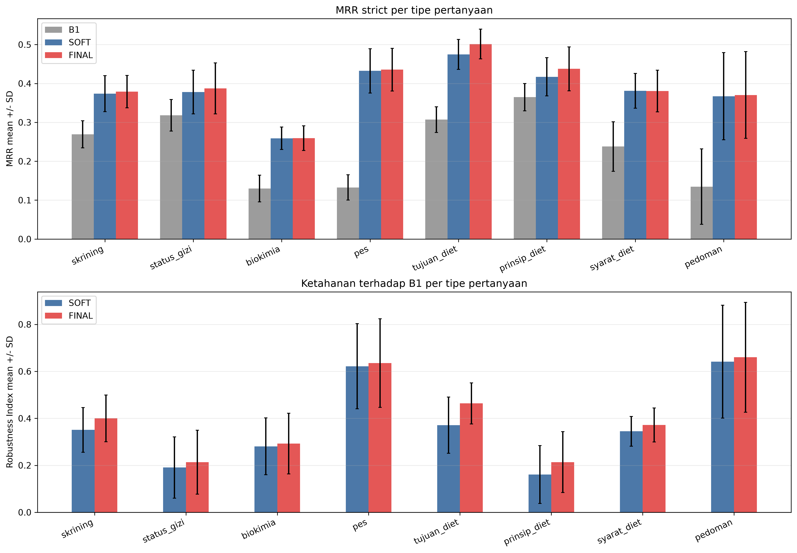
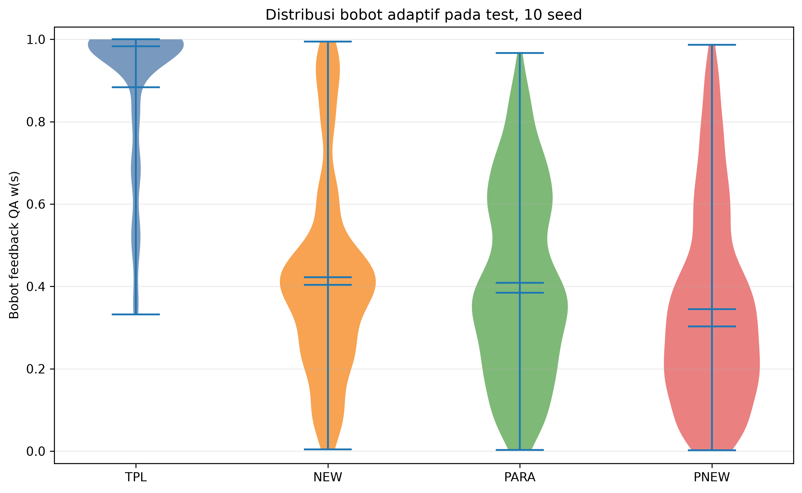

# Analisis Lanjutan

## Ruang lingkup

Analisis memakai 6.888 observasi test dari 10 seed tanpa pemilihan ulang parameter. MRR dan Robustness Index (RI) dihitung per tipe pertanyaan dengan menggabungkan empat skenario pada setiap seed, kemudian dilaporkan sebagai mean +/- sample SD antar-seed. Win/tie/loss dipool lintas seed dan selalu membandingkan metode terhadap B1.

Analisis ini hanya memakai ID dan statistik turunan. Teks pertanyaan, jawaban, chunk klinis, nama laporan, dan nama file sumber tidak disalin ke artefak Tahap 10 yang dilacak Git.

## Kinerja per tipe pertanyaan

| Tipe | N | MRR B1 | MRR SOFT | RI SOFT | MRR FINAL | RI FINAL | W/T/L FINAL |
|---|---:|---:|---:|---:|---:|---:|---:|
| skrining | 960 | 0,2693 +/- 0,0349 | 0,3739 +/- 0,0463 | 0,3510 +/- 0,0952 | 0,3790 +/- 0,0417 | 0,4000 +/- 0,0993 | 588/168/204 |
| status_gizi | 960 | 0,3181 +/- 0,0406 | 0,3781 +/- 0,0562 | 0,1906 +/- 0,1301 | 0,3873 +/- 0,0655 | 0,2135 +/- 0,1360 | 514/137/309 |
| biokimia | 948 | 0,1298 +/- 0,0342 | 0,2590 +/- 0,0288 | 0,2808 +/- 0,1207 | 0,2593 +/- 0,0316 | 0,2926 +/- 0,1295 | 590/45/313 |
| pes | 960 | 0,1327 +/- 0,0324 | 0,4325 +/- 0,0569 | 0,6219 +/- 0,1810 | 0,4354 +/- 0,0549 | 0,6354 +/- 0,1888 | 758/54/148 |
| tujuan_diet | 960 | 0,3072 +/- 0,0330 | 0,4746 +/- 0,0386 | 0,3708 +/- 0,1200 | 0,5014 +/- 0,0383 | 0,4635 +/- 0,0876 | 618/169/173 |
| prinsip_diet | 952 | 0,3647 +/- 0,0352 | 0,4172 +/- 0,0491 | 0,1607 +/- 0,1234 | 0,4375 +/- 0,0566 | 0,2135 +/- 0,1296 | 461/233/258 |
| syarat_diet | 960 | 0,2379 +/- 0,0637 | 0,3811 +/- 0,0447 | 0,3448 +/- 0,0632 | 0,3805 +/- 0,0536 | 0,3719 +/- 0,0722 | 585/147/228 |
| pedoman | 188 | 0,1347 +/- 0,0969 | 0,3672 +/- 0,1121 | 0,6413 +/- 0,2405 | 0,3703 +/- 0,1116 | 0,6600 +/- 0,2337 | 154/10/24 |

FINAL mengungguli B1 pada seluruh tipe, baik menurut MRR maupun RI. MRR FINAL tertinggi terdapat pada `tujuan_diet` (0,5014), sedangkan yang terendah adalah `biokimia` (0,2593). Kenaikan absolut terbesar atas B1 terjadi pada `pes` (+0,3027). `Pedoman` juga memperoleh kenaikan besar dan RI tertinggi, tetapi hanya memiliki 188 observasi; SD yang jauh lebih besar menunjukkan estimasinya kurang stabil dibanding tipe lain.

Reranker setelah SOFT paling membantu `tujuan_diet` (+0,0268) dan `prinsip_diet` (+0,0203). Pada `syarat_diet`, MRR FINAL sedikit lebih rendah daripada SOFT (-0,0006), walaupun RI meningkat dari 0,3448 menjadi 0,3719. Ini berarti FINAL menghasilkan lebih banyak perbaikan rank secara frekuensi, tetapi besarnya beberapa penurunan mengimbangi keuntungan tersebut pada rata-rata reciprocal rank.

## Distribusi bobot adaptif

Bobot `w(s)` menyatakan porsi sumber QA; nilai mendekati satu lebih mengandalkan feedback QA, sedangkan nilai mendekati nol lebih mengandalkan korpus eksternal.

| Skenario | N | Minimum | Q1 | Median | Q3 | Maksimum | Mean antar-seed +/- SD |
|---|---:|---:|---:|---:|---:|---:|---:|
| TPL | 1.722 | 0,3318 | 0,8195 | 0,9828 | 0,9978 | 1,0000 | 0,8835 +/- 0,0277 |
| NEW | 1.722 | 0,0043 | 0,2690 | 0,4035 | 0,5000 | 0,9948 | 0,4225 +/- 0,1063 |
| PARA | 1.722 | 0,0030 | 0,2311 | 0,3843 | 0,5957 | 0,9667 | 0,4083 +/- 0,1010 |
| PNEW | 1.722 | 0,0019 | 0,1604 | 0,3028 | 0,4718 | 0,9864 | 0,3445 +/- 0,1076 |

TPL hampir selalu diberi bobot QA sangat tinggi, sesuai tersedianya pertanyaan template identik dalam koleksi. Ketika tipe yang sama dikeluarkan, median turun menjadi 0,4035 pada NEW dan 0,3028 pada PNEW. PARA memiliki sebaran paling lebar di sekitar nilai tengah karena sebagian parafrasa dikenali dengan baik dan sebagian lainnya lebih dekat ke sumber eksternal. Ekor distribusi yang tetap mencapai nilai tinggi pada NEW/PNEW memperlihatkan bahwa similarity tidak hanya merepresentasikan identitas tipe pertanyaan; beberapa query masih sangat mirip dengan pertanyaan lintas tipe.

## Selisih SOFT dengan ORACLE-W

ORACLE-W memilih per query antara ranking QA dan eksternal berdasarkan rank gold sehingga hanya berfungsi sebagai batas atas retrospektif, bukan metode yang dapat dipakai saat inferensi.

| Skenario | MRR SOFT | MRR ORACLE-W | Gap ORACLE - SOFT |
|---|---:|---:|---:|
| TPL | 0,6185 +/- 0,0322 | 0,6567 +/- 0,0306 | 0,0381 +/- 0,0079 |
| NEW | 0,3469 +/- 0,0604 | 0,4148 +/- 0,0356 | 0,0678 +/- 0,0342 |
| PARA | 0,3466 +/- 0,0339 | 0,4839 +/- 0,0179 | 0,1373 +/- 0,0289 |
| PNEW | 0,2365 +/- 0,0217 | 0,3084 +/- 0,0176 | 0,0719 +/- 0,0202 |
| Rata-rata | 0,3871 +/- 0,0202 | 0,4659 +/- 0,0181 | 0,0788 +/- 0,0113 |

Gap terkecil terdapat pada TPL, ketika sinyal similarity paling tegas. Gap terbesar justru pada PARA (0,1373), meskipun ketepatan tipe feedback embedding pada Tahap 9 cukup tinggi. Hal ini menunjukkan bahwa tantangan utama bukan sekadar mengenali tipe, melainkan memilih sumber yang menghasilkan ranking chunk terbaik untuk setiap QA. Rata-rata masih tersedia ruang 0,0788 MRR antara pembobotan sigmoid dan keputusan oracle.

## Analisis 20 kegagalan FINAL

Kegagalan didefinisikan sebagai gold ketat berada di luar top-10 FINAL. Terdapat 1.926 dari 6.888 observasi gagal (27,96%) yang mencakup 495 QID unik. Dengan seed 20261016, dipilih 20 QID berbeda secara acak dari QID yang pernah gagal, lalu satu observasi seed-skenario gagal dipilih secara acak untuk setiap QID.

Kategori menggunakan indikator yang dapat direproduksi dan tidak membaca label test untuk penyetelan:

- `feedback_salah_tipe`: pada TPL/PARA, tidak satu pun dari lima feedback teratas bertipe sama;
- `chunk_gold_tabel`: chunk gold memiliki separator tabel Markdown;
- `jawaban_tersebar`: lebih dari satu chunk relevan pada multi-gold ambang 0,7;
- `parafrasa_tidak_dikenali`: skenario PARA/PNEW dengan bobot QA `w <= 0,25`;
- `lainnya`: tidak ada indikator di atas.

Indikator dapat bertumpang tindih. Kategori utama memakai prioritas feedback salah tipe, tabel, jawaban tersebar, parafrasa tidak dikenali, lalu lainnya. Ini adalah audit diagnostik berbasis proxy, bukan adjudikasi klinis manual.

| No. | Seed | QID | Skenario | Tipe | Rank FINAL | Kategori utama | Indikator tambahan |
|---:|---:|---|---|---|---:|---|---|
| 1 | 2 | Q0126 | PARA | status_gizi | 25 | feedback salah tipe | jawaban tersebar; parafrasa rendah |
| 2 | 9 | Q0703 | PARA | status_gizi | 13 | jawaban tersebar | parafrasa rendah |
| 3 | 2 | Q0562 | PARA | status_gizi | 41 | feedback salah tipe | gold tabel; jawaban tersebar; parafrasa rendah |
| 4 | 5 | Q0527 | PNEW | status_gizi | 15 | jawaban tersebar | parafrasa rendah |
| 5 | 3 | Q0652 | PNEW | tujuan_diet | 26 | jawaban tersebar | parafrasa rendah |
| 6 | 6 | Q0663 | PARA | pedoman | 63 | lainnya | – |
| 7 | 7 | Q0371 | PNEW | prinsip_diet | 11 | jawaban tersebar | parafrasa rendah |
| 8 | 5 | Q0555 | PNEW | status_gizi | 31 | jawaban tersebar | – |
| 9 | 5 | Q0266 | PNEW | biokimia | 162 | lainnya | – |
| 10 | 3 | Q0429 | PNEW | syarat_diet | 14 | parafrasa tidak dikenali | – |
| 11 | 10 | Q0153 | PNEW | pedoman | 17 | jawaban tersebar | parafrasa rendah |
| 12 | 3 | Q0104 | PNEW | skrining | 11 | jawaban tersebar | – |
| 13 | 5 | Q0685 | NEW | syarat_diet | 74 | lainnya | – |
| 14 | 5 | Q0592 | PNEW | pes | 17 | lainnya | – |
| 15 | 9 | Q0901 | PARA | tujuan_diet | 98 | jawaban tersebar | parafrasa rendah |
| 16 | 4 | Q0787 | PNEW | biokimia | 63 | jawaban tersebar | parafrasa rendah |
| 17 | 1 | Q0535 | NEW | biokimia | 75 | jawaban tersebar | – |
| 18 | 3 | Q0201 | NEW | pes | 33 | jawaban tersebar | – |
| 19 | 1 | Q0537 | PNEW | tujuan_diet | 79 | lainnya | – |
| 20 | 7 | Q0234 | NEW | syarat_diet | 72 | lainnya | – |

Kategori utama terdiri atas 2 feedback salah tipe, 11 jawaban tersebar, 1 parafrasa tidak dikenali, dan 6 lainnya. Jika seluruh indikator non-eksklusif dihitung, terdapat 2 kasus feedback salah tipe, 1 chunk gold berupa tabel, 13 jawaban tersebar, dan 10 parafrasa dengan bobot rendah. Dominannya label multi-gold menunjukkan bahwa satu chunk strict tidak selalu mencakup seluruh bukti yang berkaitan dengan jawaban. Enam kasus `lainnya` menandakan masih ada kegagalan yang tidak dapat dijelaskan oleh empat indikator otomatis tersebut.

Interpretasi error dibatasi oleh ukuran sampel kecil dan tidak adanya validasi manual multi-gold. Karena indikator dapat saling tumpang tindih, frekuensi non-eksklusif tidak boleh dijumlahkan sebagai persentase tunggal. Audit lanjutan oleh peneliti domain diperlukan sebelum menyimpulkan penyebab klinis atau kualitas chunk secara definitif.

## Artefak dan verifikasi

- `results/stage10/question_type_per_seed.csv` dan `question_type_summary.csv`: MRR serta RI per tipe.
- `results/stage10/weight_per_seed.csv` dan `weight_summary.csv`: distribusi bobot.
- `results/stage10/oracle_gap_per_seed.csv` dan `oracle_gap_summary.csv`: gap SOFT–ORACLE-W.
- `results/stage10/failure_sample.csv` dan `failure_summary.json`: sampel error privat tanpa teks klinis.
- `reports/figures/10_question_type_performance.png` dan `10_weight_distribution.png`: gambar agregat 300 dpi yang telah diperiksa visual.

Verifier memeriksa sepuluh hash, 24 kombinasi tipe-metode, rumus W/T/L dan RI, urutan kuantil bobot, aritmetika gap oracle, 20 QID error yang unik, rank FINAL di luar top-10, serta ketiadaan field teks klinis. Status akhir **PASS**, `test_used_for_selection=false`, dan seluruh 39 unit test repository lulus.
